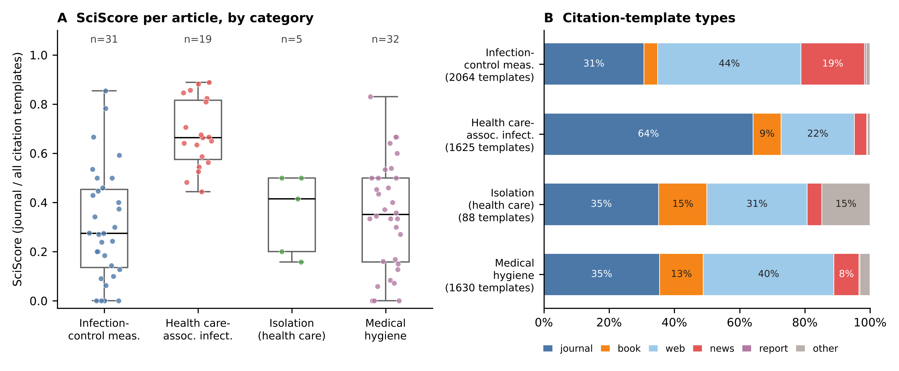
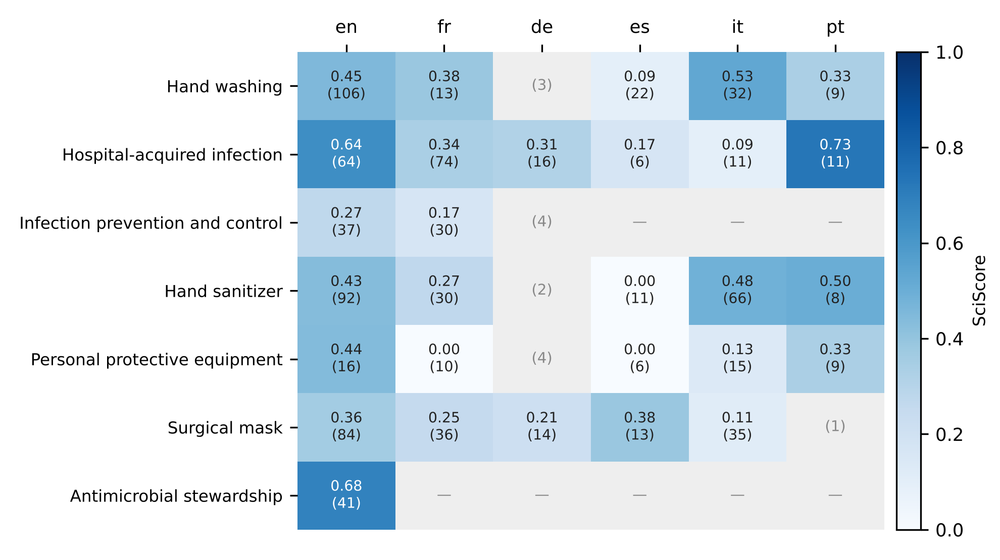

# Summary

Wikipedia is one of the most read sources of health information, for the
public as for students and clinicians [@heilman2011wikipedia;
@smith2020situating]. How trustworthy an article is depends largely on the
sources it cites, and Wikipedia's own guideline for medical content asks for
peer-reviewed secondary literature [@wikipedia2026medrs]. Checking whether an
article meets that standard, and how its sources changed over time, means
retrieving its revision history, parsing its references and looking the cited
papers up in bibliographic databases.

The wikicitation project packages these steps for three kinds of users
(\autoref{fig:ecosystem}). `wikilite` [@sobel2026wikilite] is an R package that
retrieves revision histories and category trees, parses citations, computes
quality metrics and annotates DOIs and ISBNs. `wikiliteApp`
[@sobel2026wikiliteapp] is a Shiny application built on it for users who do
not write code. `wikicitation-mcp` [@sobel2026wikicitationmcp], the software
submitted with this paper, re-implements the same methods in Python as a server
for the Model Context Protocol (MCP) [@anthropic2024mcp; @hou2025mcp], the open
standard through which AI assistants call external tools. After
`pip install wikicitation-mcp`, a user can ask an assistant, for example,
"How scientific are the sources of the Wikipedia articles on infection control,
and how has that changed since the COVID-19 pandemic?", and the assistant
answers by calling the server's 38 tools.

{#fig:ecosystem width="100%"}

# Statement of need

Wikipedia's references are studied to understand how science reaches the
public: which literature is cited [@maggio2017wikipedia; @singh2021wikipedia],
how fast new research is cited [@schmidt2023diachronic], whether open-access
papers are favoured [@teplitskiy2017amplifying], how Wikipedia absorbed the
COVID-19 literature during an "infodemic" [@zarocostas2020infodemic;
@colavizza2020covid; @benjakob2022citation], and how reference quality differs
between articles and language editions [@lewoniewski2016quality;
@nicholson2021measuring]. Each study repeats the same work: paginated,
rate-limited calls to the MediaWiki API; parsing of wikitext, where references
are written with dozens of citation templates whose names and parameters differ
between language editions; and resolution of DOIs through Crossref
[@hendricks2020crossref] and Europe PMC [@europepmc2015].

The project serves three audiences. Researchers in scientometrics, health
communication and medical informatics need reproducible audits of an article, a
category or a topic, at past dates and in several languages. Clinical and
public-health teams, librarians and educators need to check the sourcing of the
articles their patients and students read, without programming; in our case the
motivating users are infection prevention and control (IPC) specialists, whose
field relies on public adherence to evidence-based measures such as hand hygiene
[@pittet2000effectiveness; @allegranzi2009role]. Developers need Wikipedia
citation data inside agent workflows. Because every answer of the MCP server is
built from explicit tool calls, an analysis started in conversation can be
replayed by a script, as in the example below.

# State of the field

Pywikibot [@pywikibot2023] is a mature framework for reading and editing
Wikipedia, and WikipediR [@wikipedir2016] wraps the MediaWiki API for R; neither
parses citations or resolves DOIs. mwcites [@mwcite2022] extracts identifiers
from XML dumps, and the Wikipedia Citations data set [@singh2021wikipedia]
provides citations with identifiers for one snapshot of the English Wikipedia;
both suit corpus-wide batch studies, not questions about a given article at a
given date or in another language. History-flow visualisation
[@viegas2004history] and WikiWho [@flock2014wikiwho] analyse authorship rather
than sources. `wikilite` grew out of `WikiCitationHistoRy`
[@sobel2020wikicitationhistory], the R code behind @benjakob2022citation, and
remains the reference implementation of its citation parsing and SciScore.
Adding these functions to Pywikibot or mwcites would not fit their purposes
(editing automation and offline dump processing). An MCP server, in turn, needs
a small, validated set of tools with structured outputs rather than a general
library, which is why the Python server was written as a separate package
instead of wrapping R.

# Software design

`wikilite` (R ≥ 4.1) uses `httr2`, `WikipediR`, `europepmc` and `rcrossref`
and returns data frames, with `ggplot2`, `plotly` and `visNetwork`
visualisations and xlsx or BibTeX export. `wikiliteApp` [@shiny2024] adds
history-flow views [@viegas2004history], token-level authorship through WikiWho
[@flock2014wikiwho], edit-war detection and corpus comparison through co-citation
and wikilink networks. `wikicitation-mcp` is written with FastMCP
[@fastmcp2024] and `mwparserfromhell` [@mwparserfromhell]; its 38 tools cover
article history and metadata, corpus construction from categories (up to five
levels deep), counting and parsing of references (DOIs, URLs, ISBNs, PMIDs,
regular expressions, one structured row per citation template), quality metrics,
and annotation through Europe PMC, Crossref, Open Library and Google Books.

Four choices shape both libraries. *A shared metric.* SciScore, the share of
citation templates that cite journal articles, follows @benjakob2022citation; a
registry maps the templates and parameter names of the English, French, German,
Spanish, Italian and Portuguese editions to common types and fields, so that the
metric is comparable across languages. *Date-aware results.* Every
article-level function accepts an upper date bound and returns the revision
identifier it used, so any result can be replayed on a past snapshot.
*Composable, inspectable steps.* Small functions (or tools) return tables or
JSON, so that each intermediate result (category, articles, citations, DOIs,
metadata) can be checked by the user or shown by the assistant. *Safe and polite
access.* Because MCP arguments are written by a language model and may echo text
from untrusted pages, the server validates list sizes, text and regular
expression lengths, language codes, DOIs, ISBNs and dates before any network
call; HTTP clients throttle per host, retry with back-off that honours
`Retry-After`, and follow MediaWiki's `maxlag` convention.

The Python server has 90 offline unit tests, which mock HTTP and drive the
server in-process through an MCP client, and 13 integration tests against the
live APIs, run in continuous integration on Python 3.10 to 3.13; `wikilite` has
114 `testthat` tests, run with `R CMD check` and coverage reporting in
continuous integration.

# Example: infection prevention and control on Wikipedia

As a worked example, not a research result in itself, we audited how English
Wikipedia covers IPC, starting from one request to an assistant connected to
`wikicitation-mcp`:

> *"List the articles in the English Wikipedia categories on infection-control
> measures, health care-associated infections, isolation and medical hygiene.
> Compute the SciScore and the share of citations with a DOI of each article
> today and on 1 January of every second year since 2010, and compare the key
> articles across language editions."*

The assistant answers with `get_category_pages`, then, for each article and
date, `get_article_recent`, `get_sci_score`, `get_citation_types` and
`parse_citations` with a `date_limit`, and `annotate_dois_crossref` for the
cited papers. The script
`paper/reproduce_ipc_example.py` replays exactly these tool calls, and
`paper/make_ipc_figures.py` produces the figures and numbers below; raw data,
including the revision identifier of every snapshot, are in `paper/data/`.

On 1 November 2026 the four categories held 97 articles; with two further key
articles, the corpus had 99 articles, 5,078 citation templates and 1,916 unique
DOIs. The median SciScore of the 79 articles with at
least five templates was 0.43, with clear differences between categories
(\autoref{fig:categories}): articles on health care-associated infections, many
of them on pathogens, relied mainly on journals (median 0.66), whereas articles
on infection-control measures relied mainly on web and news sources (median
0.27). The overview article *Infection prevention and control* had a SciScore of
only 0.27.

{#fig:categories width="100%"}

Replaying the audit on past snapshots shows how the COVID-19 pandemic reshaped
this corpus (\autoref{fig:time}). During 2020 the number of citation templates
rose by half, from 2,523 to 3,873, and the share carrying a DOI fell from 49% to
39%, where it has stayed. Thirteen articles created during 2020, such as *Face
masks during the COVID-19 pandemic* and *N95 respirator*, brought 812 templates,
only 14% of them citing journals; the 77 existing articles also turned towards
web and news sources (journal templates 55% to 51%). Some core articles lost scientific weight that
they have not recovered, *Hand washing* falling from 0.68 to 0.40 between 2020
and 2022 and *Hand sanitizer* from 0.60 to 0.44 in 2020, while *Surgical mask* and
*Infection prevention and control* gained. These patterns extend to IPC what
@benjakob2022citation found for COVID-19 articles.

{#fig:time width="100%"}

The same tools compare language editions (\autoref{fig:languages}). English
articles usually had the most templates and the highest SciScore; for
*Hospital-acquired infection* it was 0.64 in English against 0.34 in French.
Such comparisons need care: German and other editions often write references
without templates, which the metric does not see, and several key articles have
no counterpart in some languages.

{#fig:languages width="80%"}

For IPC teams, such audits point to articles worth editing, such as the
overview article and *Hand washing*, and return the cited literature in reusable
form (`paper/table1_ipc_top_papers.md`).

# Research impact statement

The methods implemented here come from a peer-reviewed study of Wikipedia's
COVID-19 coverage [@benjakob2022citation], whose R code
[@sobel2020wikicitationhistory] became `wikilite`. `wikicitation-mcp` is
distributed on PyPI and archived on Zenodo [@sobel2026wikicitationmcp];
`wikilite` has been submitted to CRAN. At the
University Hospital of Geneva, the MCP server is the basis of a French-language
tutorial with eleven IPC use cases (mapping a domain, auditing an article's
sources, dating the arrival of a topic, comparing languages, building a
bibliography), prepared to train IPC staff to evaluate the health information
that patients and the public read. All three packages are open source (MIT for the
Python server and the Shiny application, GPL-3 for `wikilite`), with
documentation, changelogs, tests and contribution guidelines.

# AI usage disclosure

Generative AI was used in this work. Claude (Anthropic; models
`claude-sonnet-4-6` and `claude-opus-5-5`, used through Claude Code) assisted
with code generation and refactoring, test scaffolding, code audits, the
analysis scripts of the example, and drafting and editing the text of this paper
and of the documentation. The author made the architectural and design
decisions and reviewed, modified and validated all AI-generated code and text.
Correctness was checked by the automated test suites, by running the tools
against the live APIs, and by resolving every DOI in the bibliography through
Crossref. All numbers and figures come from the scripts distributed with the
paper, not from the language model.

# Acknowledgements

The author thanks Omer Benjakob and Rona Aviram for the collaboration that
motivated this software, colleagues of the Division of Infection Prevention and
Control of the University Hospital of Geneva, and the maintainers of the
MediaWiki API, FastMCP, `mwparserfromhell`, Europe PMC and Crossref. No external
funding was received.

# References
