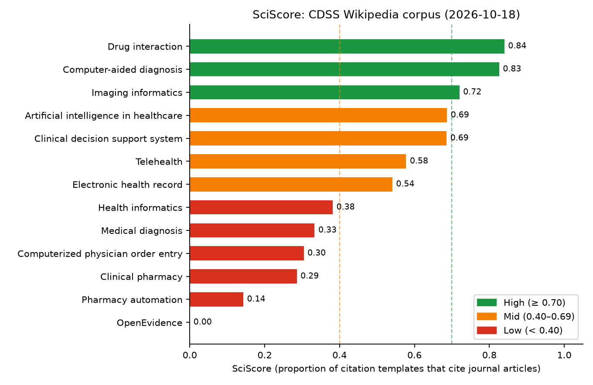

# Summary

Wikipedia is a major source of health and science information for the public,
students and clinicians [@heilman2011wikipedia; @smith2020situating].  The
reliability of an article depends largely on the sources it cites, and the
encyclopaedia's own guideline for medical content asks editors to rely on
peer-reviewed secondary literature [@wikipedia2026medrs].  Checking whether an
article meets that standard, and how its sources change over time, requires
retrieving its revision history, parsing its references and looking the cited
papers up in bibliographic databases.

`wikicitation-mcp` makes these analyses available to anyone who uses an AI
assistant.  It is a server for the Model Context Protocol (MCP)
[@anthropic2024mcp; @hou2025mcp], the open standard through which assistants
such as Claude call external software.  After `pip install wikicitation-mcp`,
a user can ask in plain language, for example, "Which journals does the
Wikipedia article on clinical decision support rely on, and how has that
changed since 2015?".  The assistant answers by calling the server's 38 tools,
which return structured data: revision histories, parsed citations, quality
scores and bibliographic metadata.

# Statement of need

Wikipedia's references are studied to understand how science reaches the
public: which literature is cited [@maggio2017wikipedia; @singh2021wikipedia],
how quickly new research is cited [@schmidt2023diachronic], whether open-access
papers are favoured [@teplitskiy2017amplifying], how Wikipedia handled the
COVID-19 literature [@colavizza2020covid; @benjakob2022citation], and how
reference quality varies across articles and languages
[@lewoniewski2016quality; @nicholson2021measuring].  Each of these studies
needs the same steps: paginated, rate-limited calls to the MediaWiki API;
parsing of wikitext, in which references are written with dozens of citation
templates whose names and parameters differ between language editions; and
resolution of DOIs through Crossref [@crossref2024] and Europe PMC
[@europepmc2023].

The R package `wikilite` [@sobel2024wikilite] implements these steps for R
users; `wikicitation-mcp` packages them as tools that an assistant can combine
on demand, without requiring R.  It serves three audiences: researchers in scientometrics, health
communication and medical informatics who want fast, reproducible audits of an
article, a category or a topic across languages; librarians, educators and
journalists who want to check the sourcing of an article without writing code;
and developers who want Wikipedia citation data inside agent workflows.
Because every answer is built from explicit tool calls with their arguments,
the same analysis can be replayed by a script, as in the example below.

# State of the field

Pywikibot [@pywikibot2023] is a mature framework for reading and editing
Wikipedia, and WikipediR [@wikipedir2016] wraps the MediaWiki API for R; neither
parses citations or resolves DOIs.  mwcites [@mwcite2022] extracts identifiers
from XML dumps, and the Wikipedia Citations data set [@singh2021wikipedia]
provides citations with identifiers for one snapshot of the English Wikipedia;
both suit corpus-wide batch studies but not questions about a given article at
a given date or in another language.  `wikilite` [@sobel2024wikilite], the R
package that implements the methods of @benjakob2022citation, is the closest
tool and serves as the reference implementation for the SciScore and citation
parsing logic; it requires R and scripting.

`wikicitation-mcp` is, to our knowledge, the only tool that combines
date-aware revision retrieval, multilingual citation parsing, quality metrics
and DOI annotation behind an interface designed for AI assistants.  Adding
these functions to Pywikibot or mwcites would not fit their purposes (editing
automation and offline dump processing), and an MCP server needs a small,
well-validated set of tools rather than a general library interface.

# Software design

The server is written in Python with FastMCP [@fastmcp2024] and
`mwparserfromhell` [@mwparserfromhell].  Its 38 tools fall into five groups:
article history and metadata, including snapshots at any past date and in any
language edition; corpus construction from Wikipedia categories (up to five
levels deep, up to 100 articles per call); counting, extraction and parsing of
references (DOIs, URLs, ISBNs, PMIDs, regular expressions, and structured rows
for each citation template); quality metrics, including SciScore, the share of
citation templates that cite journal articles, adapted from
@benjakob2022citation; and
annotation of DOIs and ISBNs through Europe PMC, Crossref, Open Library and
Google Books.  Five design choices shape the tool set.

*Composable tools.*  Small tools that return JSON let the assistant show and
check each intermediate result (category, articles, citations, DOIs,
metadata), so that an analysis stays inspectable; batch variants keep the
number of calls low.

*Date-aware and consistent.*  Every article-level tool accepts an upper date
bound, so any analysis can be replayed on past snapshots.  Wikitext is cached
per article, date and language, so that all metrics computed in one session
refer to the same revision, whose identifier is returned with the results.

*Multilingual parsing.*  A registry maps the citation templates and parameter
names of the English, French, German, Spanish, Italian and Portuguese editions
to common types and fields, which makes metrics comparable across languages.

*Validated input.*  Tool arguments are written by a language model and may
echo text from untrusted pages, so list sizes, text and regular-expression
lengths, language codes, DOIs, ISBNs and dates are checked before any network
call, and errors are returned as messages the assistant can act on.

*Responsible use of public APIs.*  HTTP clients pool connections, throttle
requests per host, retry with exponential back-off that honours `Retry-After`,
and follow MediaWiki's `maxlag` convention.

The test suite has 90 offline unit tests, which mock the HTTP clients and drive
the server in-process through an MCP client, and 13 integration tests against
the live APIs; continuous integration runs the unit tests on Python 3.10 to
3.13 and the integration tests in a separate weekly job.

# Research impact statement

The methods implemented here were used in a peer-reviewed study of Wikipedia's
COVID-19 coverage [@benjakob2022citation].  `wikicitation-mcp` is distributed
on PyPI and GitHub under the MIT licence, with documentation, a changelog,
contribution guidelines and the test suite described above.

As a worked example of the workflow, not as a research result in itself, we
audited 13 English Wikipedia articles on clinical decision support systems
(CDSS) [@sutton2020overview] and neighbouring topics on 18 October 2026, using
nine of the 38 tools.  The articles contain 1,027 citation templates, 55% of
which carry a DOI (555 unique DOIs).  SciScore ranges from 0.00 to 0.84
(\autoref{fig:sciscore}), from *Drug interaction* and *Computer-aided
diagnosis*, which rely mainly on journals, to *OpenEvidence*, a commercial AI
platform that cites only web and news sources.  Table S1
(`paper/tableS1_top40.md`, also as CSV and spreadsheet) lists the 40 most-cited
papers with their Crossref citation counts, open-access status and citing
article; it includes the CDSS reviews of @garg2005cdss and @kawamoto2005cdss
and the order-entry studies of @bates1998cpoe and @koppel2005cpoe, as well as
general-context papers, a reminder that citation counts measure prominence, not
relevance.  Because every tool accepts a date bound, the same audit can be
replayed on yearly snapshots (\autoref{fig:time}): for the nine articles that
had citation templates in January 2012, the number of templates rose from 97
to 662 and the share carrying a DOI from 20% to 49%.  The same tools scale from
articles to categories (200 articles from four categories) and to other
language editions, where SciScores must be interpreted with care because
references written without templates are invisible to the metric.

The scripts and raw data behind this example are in the `paper/` directory of
the repository and of its archived release, so that it can be reproduced or
applied to another topic; results change as Wikipedia is edited.

{#fig:sciscore width=70%}

{#fig:time width=100%}

# AI usage disclosure

Generative AI was used in this work.  Claude (Anthropic; models
`claude-sonnet-4-6` and `claude-opus-5-5`, used through the Claude Code
command-line tool) assisted with code generation and refactoring, test
scaffolding, code audits and the analysis scripts of the worked example, and
with drafting and editing the text of this paper and of the documentation.  The
author made the architectural and design decisions, and reviewed, modified and
validated all AI-generated code and text.  Correctness was checked by running
all 38 tools against the live APIs, by the automated test suite, and by
verifying every bibliographic reference against Crossref, arXiv or the
publisher.  The AI did not draw the conclusions reported here; all numbers and
figures come from the scripts distributed with the paper.

# Acknowledgements

The author thanks Omer Benjakob and Rona Aviram for the collaboration that
motivated this software, and the maintainers of FastMCP, `mwparserfromhell`,
Europe PMC and Crossref.  No external funding was received.

# References
